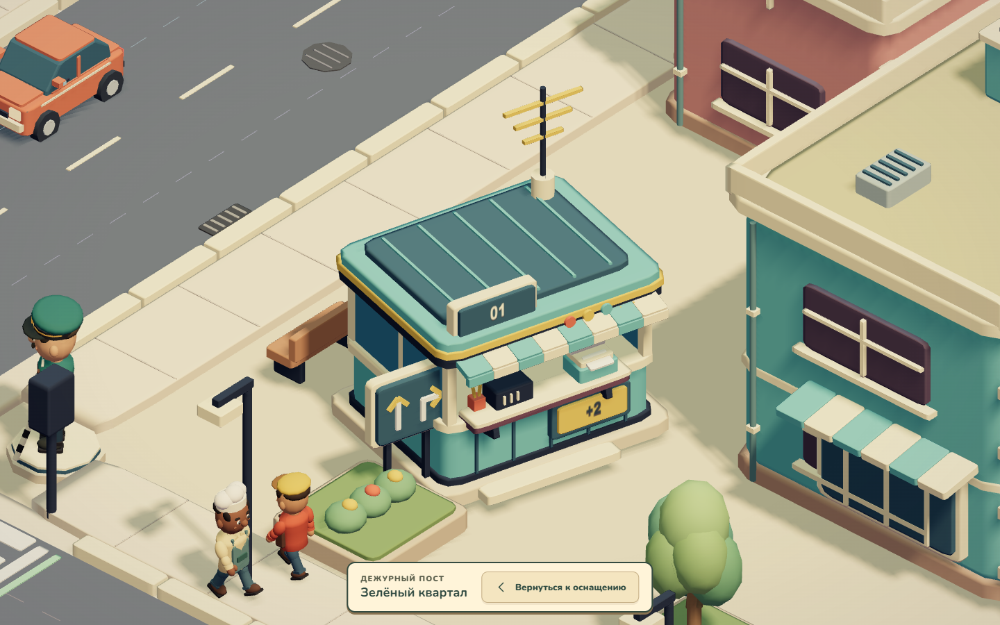

# Карьера регулировщика

**Смена → жалованье → оборудование на посту → новая тактика → аттестация.** Игрок сам решает, кого пропустить. Хороший пост даёт ему информацию и оплачивает умелую работу.

## Что дали референсы

В **(the) Gnorp Apologue** приобретение меняет и способ добычи ресурса, и то, что видно в мире. Для Traffino это повод показать ведомость, табло и антенну непосредственно на перекрёстке. Игрок, который купил табло, может подготовиться к повороту второй машины ещё до того, как первая тронется. [Описание от разработчика](https://gnorp.dev/)

В **Antimatter Dimensions** у сброса явно оговорены цена и долгосрочное преимущество. В Traffino подходящий момент для такого решения — между сменами. Игрок читает условия аттестации и сам выбирает дежурство, после которого хочет её пройти. [Игровая справка разработчиков, разделы Dimension Boosts и Infinity](https://github.com/IvarK/AntimatterDimensionsSourceCode/blob/master/src/core/secret-formula/h2p.js)

## Первый игровой цикл

1. Во время смены игрок видит предварительную сумму в ведомости. Для выплаты надо отработать до конца таймера и выполнить задание. Уход, провал нормы, критическая пробка и аварийное завершение дают ноль за текущее дежурство. Коллекция, статистика и репутация сохраняются.
2. Начальная ставка составляет одну монету за проведённую машину плюс четыре за закрытую ведомость. В сюжете улучшение личной медали даёт ещё две монеты за каждую новую звезду. В «Час пик» нужно провести 24 машины за 150 секунд. В свободном и строгом режимах касса закрывает ведомость каждые 120 секунд при норме 16 машин. Игрок может продолжить ту же партию. Деньги за закрытые ведомости уже в кошельке. За городские задания начисляется опыт.
3. Оборудование выбирают между сменами.

В каждой ветке базовый талант открывает две покупки в любом порядке. Вершина требует обеих.

| Ветка | Базовый талант | Первый путь | Второй путь | Вершина |
|---|---|---|---|---|
| Управление движением | Табло, 48 ◈. Видно манёвр второй машины | Рация, 96 ◈. Ещё 6 с для спецтранспорта | Чувство ритма, 80 ◈. Поток спадает на 35% медленнее | Зелёный коридор, 145 ◈. Автобусы и спецтранспорт разгоняются на 20% быстрее |
| Оплата труда | Ведомость, 48 ◈. Ещё 1 ◈ за проезд | Премиальный тариф, 96 ◈. Ещё 1 ◈ за ожидание короче 12 с при потоке от ×2 | Безаварийная смена, 84 ◈. Доплата 8 ◈ за оплаченный период без ДТП | План перевозок, 150 ◈. Доплата 1 ◈ за каждые четыре машины в оплаченной смене |
| Дорожная служба | План работ, 42 ◈. Предупреждение на 4 с раньше | Дежурная бригада, 88 ◈. Ремонт и устранение последствий ДТП на 3 с быстрее | Резерв времени, 76 ◈. Ещё 3 с на разбор пробки | Свой эвакуатор, 135 ◈. Поломки и ДТП устраняются ещё на 3 с быстрее |

Для аттестаций нужно обслужить 90, затем 160 и 240 машин за соответствующий срок. В зачёт идут проезды из оплаченных ведомостей. Регулировщик выбирает специальность с базовым талантом и хотя бы одним талантом второй ступени и закрепляет её базовый навык. Новая должность даёт постоянную надбавку в одну монету за проезд. Кошелёк, временное оборудование и счётчик срока обнуляются после подтверждения. Медали, коллекция, форма, репутация и предыдущие аттестации сохраняются.

В контрольном прохождении первый золотой результат принёс 28 монет за 18 машин. Табло удалось купить после второй смены. При последовательном выборе табло, ведомости и дорожной службы бот получил повышения после 4-й, 8-й и 13-й оплаченных смен. Он использовал обычные сигналы, общий стоп и объезд. Для замера темпа у новых игроков нужен плейтест.

## Очерёдность разработки и проверки

| Этап | Что можно оценить в игре | Условие перехода дальше |
|---|---|---|
| Первый пост | Инструктаж, три пути развития, ведомость заработка, покупка и её модель в городе, повышение | Новый игрок называет источник монет, видит эффект первой покупки и может объяснить последствия повышения до подтверждения |
| Характер районов | Портовые заказы и утренние маршруты квартала предлагают разные причины менять специализацию | В двух районах игрок сознательно применяет разные приёмы |
| Длинная карьера | Контракты старших должностей и новые схемы перекрёстков | Повторный срок даёт новое решение в потоке. Темп и цены подбираются по записям реальных игровых сессий |

При объезде игрок указывает водителю другой выезд и сам открывает сигнал, когда путь свободен. Во время паузы таймер дежурства и отсчёт дорожных событий стоят.
