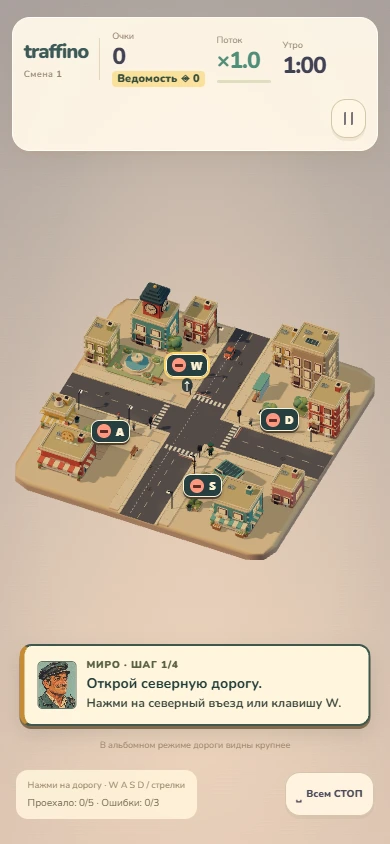

# Traffino

Игра про регулировщика в игрушечном 3D-городе. В этой ветке доступна автономная версия для Windows x64. Пропускайте машины, предотвращайте аварии и удерживайте поток.

- Режимы «Час пик», бесконечный и хардкорный.
- Three.js, поддержка мыши и сенсорного управления.

## Windows

Для сборки нужны Node.js 22.12+ и npm. Выполните `npm ci`, затем `npm run desktop` для запуска или `npm run package:windows` для сборки. Команда выведет путь к `Traffino.exe`. Для передачи игроку скопируйте всю папку рядом с этим EXE. На игровом ПК Node.js устанавливать не нужно.

WASD или стрелки переключают направления, пробел останавливает потоки, Esc ставит смену на паузу, F11 переключает полный экран. В режиме «Час пик» можно заработать ещё 120 очков за каждую серию, в которой машины со всех четырёх сторон проехали без аварии.

[Аудит и план плейтеста для Steam](STEAM_AUDIT.md)

## Запуск в браузере

```bash
npm ci
npm run dev
```

Откройте [локальную игру](http://127.0.0.1:4180). Тесты запускаются командой `npm test`.

## Скриншоты



