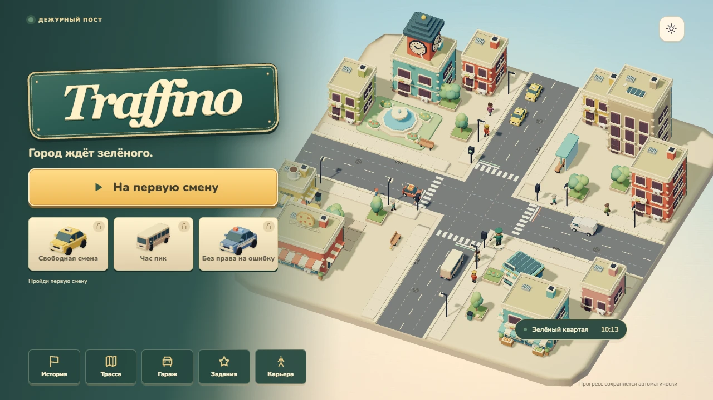
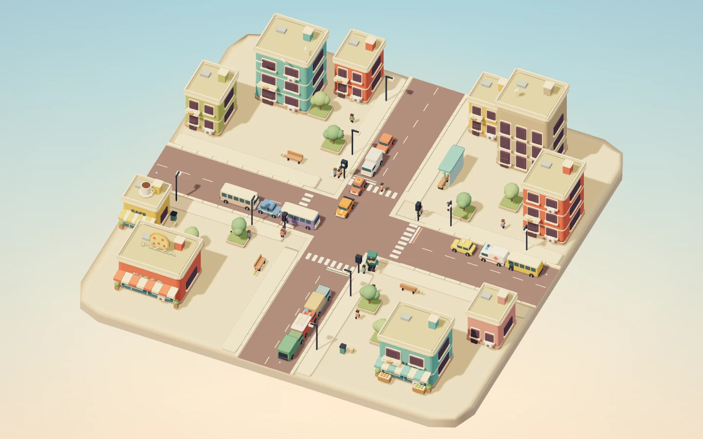

# Traffino

Браузерная игра про управление перекрёстками в игрушечном 3D-городе. Пропускайте машины, предотвращайте аварии и удерживайте поток.

- Режимы «Час пик», бесконечный и хардкорный.
- Three.js, поддержка мыши и сенсорного управления.

## Запуск

```bash
npm ci
npm run dev
```

Откройте [локальную игру](http://127.0.0.1:4180). Тесты запускаются командой `npm test`.

## Скриншоты




