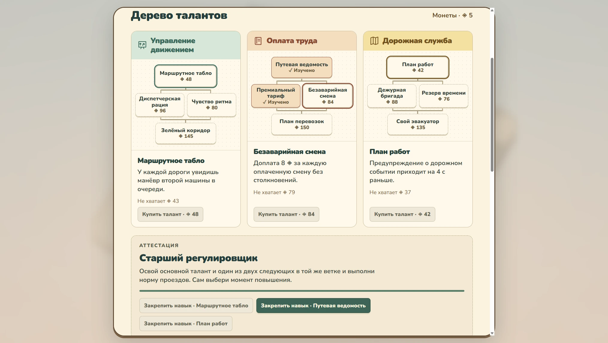
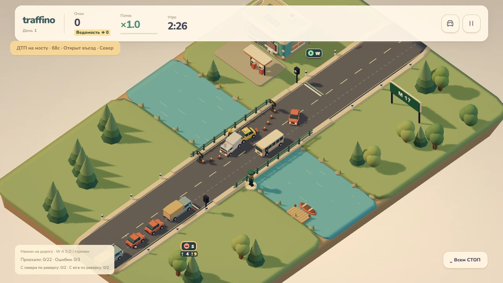
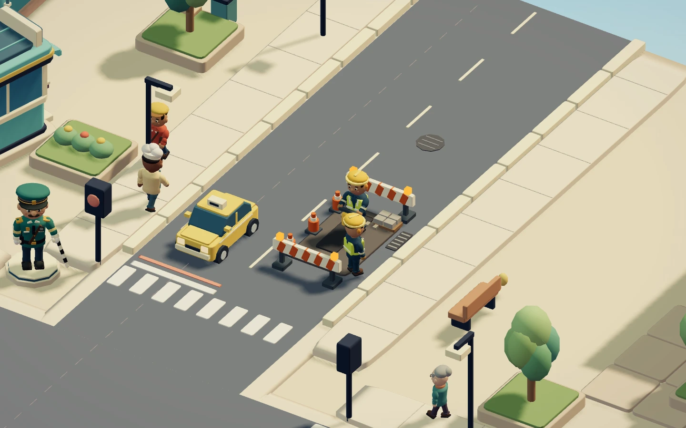
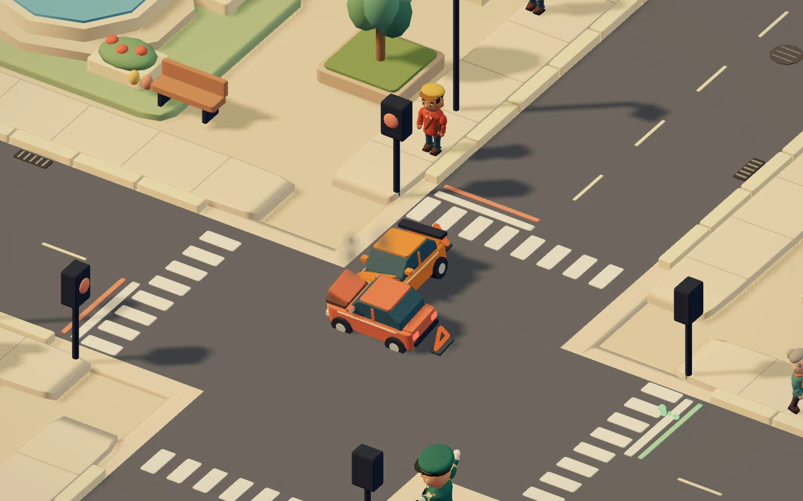
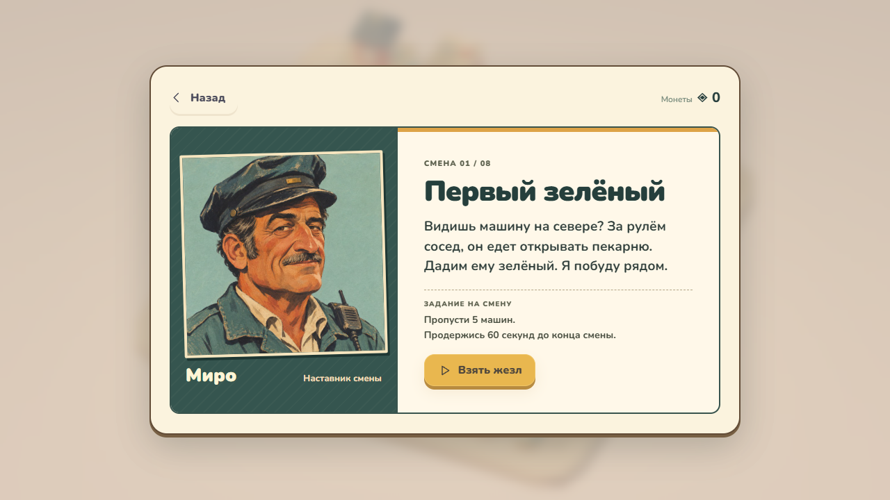
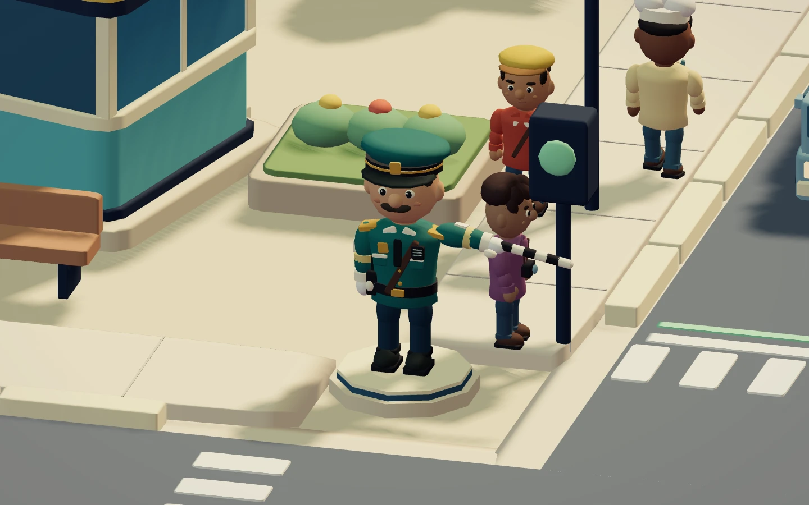
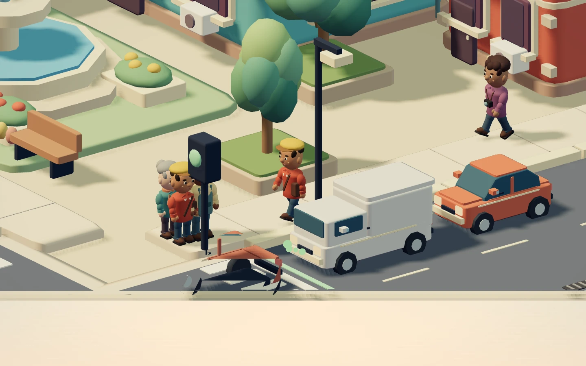

# Traffino

Игра про регулировщика в игрушечном 3D-городе. В этой ветке доступна автономная версия для Windows x64. Пропускайте машины, предотвращайте аварии и удерживайте поток.

- Режимы «Час пик», бесконечный и хардкорный.
- Three.js, поддержка мыши и сенсорного управления.

## Windows

Для сборки нужны Node.js 22.12+ и npm. Выполните `npm ci`, затем `npm run desktop` для запуска или `npm run package:windows` для сборки. Команда выведет путь к `Traffino.exe`. Для передачи игроку скопируйте всю папку рядом с этим EXE. На игровом ПК Node.js устанавливать не нужно.

Нажмите на компактный сигнал у дороги или на саму въездную полосу. Красная черта означает стоп, зелёная стрелка разрешает движение, жёлтые песочные часы на мосту означают ожидание встречной колонны. WASD или стрелки переключают направления, пробел останавливает потоки, Esc ставит смену на паузу, F11 переключает полный экран. В режиме «Час пик» можно заработать ещё 120 очков за каждую серию, в которой машины со всех четырёх сторон проехали без аварии.

Жалованье зачисляется после полной смены с выполненным заданием. В свободном и строгом режимах одна ведомость охватывает 120 секунд и минимум 16 проездов. В «Час пик» норма составляет 24 машины за 150 секунд.

В главном меню откройте «Трасса» и выберите вызов на мост М-17. Поломка автобуса занимает 36–58 секунд, расчистка ДТП — 64–88 секунд. Дайте зелёный с севера клавишей W либо с юга клавишей S. Запрос встречного направления закрывает текущий въезд. Когда хвост колонны покинет мост, откроется встречный сигнал. Пробел отменяет запрос. За 150 секунд нужно провести 22 машины, включая минимум по две с каждой стороны во время реверса. [Запись смены направления в игре](screenshots/highway-convoys.webm)

После смены откройте «Дерево талантов» или зайдите в «Карьеру» из главного меню. Жалованье можно вложить в 12 талантов трёх специальностей. Выберите узел, чтобы увидеть эффект, цену и условия покупки. После базового таланта можно выбрать любую из двух специализаций. Вместе они открывают вершину ветки. При повышении выбранный базовый талант становится постоянным.

[Карьера, экономика и следующие игровые этапы](CAREER_DESIGN.md) · [Аудит и план плейтеста для Steam](STEAM_AUDIT.md)

## Запуск в браузере

```bash
npm ci
npm run dev
```

Откройте [локальную игру](http://127.0.0.1:4180). Тесты запускаются командой `npm test`.

Чтобы рассмотреть персонажей вблизи, во время смены нажмите Esc, откройте «Фоторежим» и в поле «В кадре» выберите «Регулировщик» или «Прохожие». Перед первой сменой можно расспросить Миро об управлении и жалованье.

Во время работ нажмите «Объезд» или R, чтобы направить остановившегося водителя к другому выезду. Проверьте новый поворот перед зелёным сигналом. Если над машиной появился жёлтый восклицательный знак, общий стоп удержит нарушителя у линии. Место ремонта, поломки или ДТП можно осмотреть через фоторежим.

## Скриншоты














