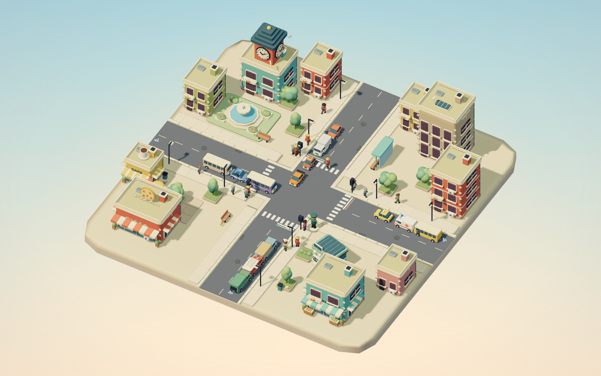
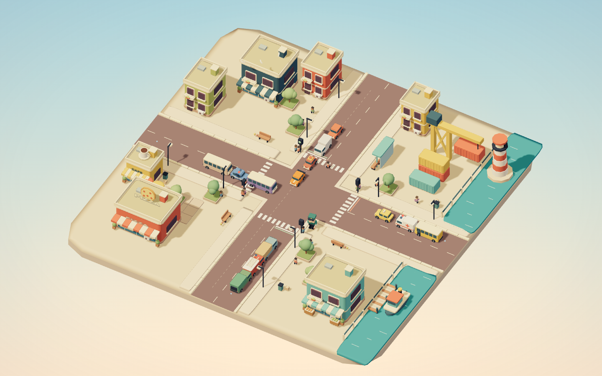

# Traffino — аудит настольной версии

Исходная точка — `main` на коммите `8e5fcab`. Игрок регулирует каждое направление отдельно. Встречные машины могут ехать одновременно, а ошибка в выборе момента приводит к столкновению. Отдельная симуляция уже обслуживает восемь сюжетных смен, свободную игру, час пик и хардкор. Предлагаю сохранить Three.js и эту систему правил. Для первого Windows-плейтеста достаточно поставлять собственное игровое окно и браузерный движок вместе с игрой.

| Приоритет | Что показал аудит | Результат или следующий шаг |
|---|---|---|
| Запуск на ПК | Предыдущая сборка рассчитывала на сайт, путь `/sdk.js` и внешнюю платформу. | Добавлена автономная Windows x64 сборка на Electron. Ресурсы открываются из комплекта игры. Результаты и настройки хранятся локально, F11 переключает полный экран. |
| Различимость районов | Почти все здания повторялись. Полоса воды и ограда пересекали траекторию восточного въезда. | В Зелёном квартале появились ратуша с часами, фонтан и цветники. В порту теперь две гавани по сторонам дороги, маяк, кран с грузом, причал и буксир. Снижена экспозиция, чтобы светлые детали читались лучше. |
| Решения в «Час пик» | Очки и поток поощряли пропуск транспорта. Короткая серия на всех подходах не имела собственной цели. | За полный круг без аварии начисляются 120 очков. Учитывается машина, покинувшая перекрёсток. Повторное обслуживание стороны не закрывает другую. HUD показывает оставшиеся стороны, итог смены содержит число кругов. |
| Продолжительность и освоение | Таймеры восьми смен дают 705 секунд игрового времени при прохождении с первой попытки. Далее интерес зависит от свободной игры, медалей и рекордов. | Для следующего плейтеста дать новому игроку пройти обучение, открыть «Час пик» и сыграть его дважды. Записать, когда он понял поворот первой машины, заметил ли бонус круга и зачем начал вторую попытку. По результату выбрать между изменением подсказок и новой сменой с другой дорожной схемой. |
| Управление | Направления и общий стоп доступны с клавиатуры, переход пешехода требует попадания по экранной кнопке или навигации по фокусу. | Перед поддержкой контроллера проверить полный цикл от меню до результатов без мыши и подобрать удобное действие для каждого перехода. |
| Выпуск в Steam | Локальный исполняемый файл есть. Запуск из библиотеки Steam, оверлей, перенос прогресса на другой ПК и производительность на целевом железе ещё требуют проверки. | Следующий рубеж — закрытая ветка в Steamworks, установка на чистый ПК, две сессии с перезапуском и замер времени кадра в плотном потоке. Для обещания Steam Cloud потребуется отдельная реализация и проверка. |
| Права на графику | Для двух PNG с транспортом и магазинами в комплекте исходных референсов нет явного разрешения на коммерческое распространение. | Перед публичным выпуском подтвердить права или заменить листы собственными изображениями. Происхождение остальных материалов описано в ART_STYLE_GUIDE.md. |

Сборка в этой ветке рассчитана на Windows x64, мышь и клавиатуру. Запуск устроен через `Traffino.exe` и каталог ресурсов рядом с ним. Всю выходную папку можно использовать при подготовке депо. [Загрузка сборок в Steam](https://partner.steamgames.com/doc/sdk/uploading)

## Как повторить проверку

После `npm ci` запустить `npm test` для проверки механик, миграции сохранений, экономики и прохождения кампании. Визуальный прогон `node scripts/browser-smoke.mjs --art` использует Chrome с программным рендерингом. Он показывает компоновку, число вызовов отрисовки и влияние качества на сложность сцены. Для FPS и времени кадра нужен целевой ПК.

Собрать игру командой `npm run package:windows`. Переменной окружения `TRAFFINO_TEST_EXE` присвоить выведенный абсолютный путь к EXE и запустить `node scripts/browser-smoke.mjs`. Проверка использует временный профиль, входит в первую смену, открывает север, дожидается очков, завершает партию и проверяет сохранение после перезагрузки игры.

## Кадры из игры

Для этапа «Первый пост» на Windows x64 прошли 45 модульных тестов, включая перенос прежних сохранений и прохождение обеих аттестаций. Визуальный прогон прошёл 18 проверок. В контрольной сцене SwiftShader отрисовал 30 648 треугольников на Low и 163 610 на Medium. В упакованном EXE проверены портрет и подсказки с первого кадра, начисление жалованья, условия аттестации и восстановление закреплённого навыка и медали после перезапуска. Темп развития ещё нужно проверить с игроками.
